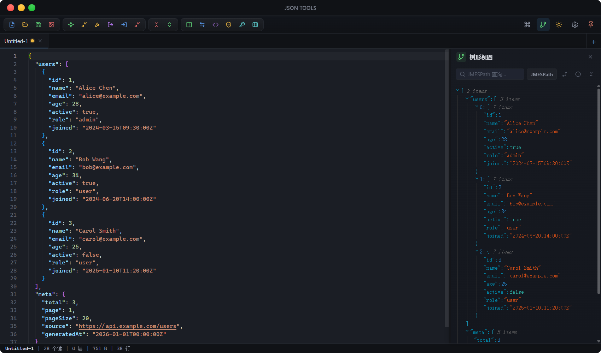

# JSON TOOLS

<p align="center">
  
</p>

<p align="center">
  <a href="https://github.com/firework-a/json-tools/releases"></a>
  <a href="https://github.com/firework-a/json-tools/releases"></a>
  <a href="https://github.com/firework-a/json-tools/actions"></a>
  <a href="./LICENSE"></a>
  <a href="https://tauri.app/"></a>
  <a href="https://react.dev/"></a>
  <a href="https://www.typescriptlang.org/"></a>
</p>

<p align="center">
  面向开发者的桌面 JSON 工作台 · 离线运行 · 原生窗口 · 轻量快速
</p>

---

JSON TOOLS是一个面向开发者的桌面 JSON 工作台，基于 Tauri 2、React 18 与 Monaco Editor 构建。它把常见的 JSON 处理流程整合在一个离线本地应用里，适合日常格式化、压缩、转义、修复、格式转换、Mock 数据、智能分析、Schema 校验、多语言类型生成、对比与代码图片导出。

## 核心能力

- JSON 格式化、压缩、转义和解转义（粘贴单行 JSON 自动美化）
- JSON 修复：自定义修复规则 + jsonrepair 兜底，覆盖注释 / 单引号 / 尾逗号 / 截断 payload 等非标准 JSON
- 多标签页编辑，支持文件打开 / 保存 / 另存为，带未保存状态提示（中键关闭标签）
- 文件拖拽打开（`.json` / `.txt` / `.yaml` / `.yml`），编辑器外 `Ctrl+V` 直接粘贴剪贴板内容
- JSON 树形结构查看，支持 JMESPath / JSONPath 双查询语言（速查表、历史记录、结果写回编辑器）
- JSON Diff 对比，行级差异高亮，一键生成/应用 RFC 6902 JSON Patch
- Mock 数据生成：从样例结构或 JSON Schema 生成仿真数据
- 键名风格批量转换：递归在 camelCase / snake_case / kebab-case / PascalCase 间互转，撞名时报错不丢数据
- JSON 深度合并：以编辑器内容为基准、粘贴内容为增量，数组支持整体替换/拼接/并集去重，标量冲突可指定取舍侧
- 敏感字段脱敏：按键名与值格式（手机号 / 身份证 / 邮箱 / JWT / IP / 卡号 / 长随机串）递归打码，附命中清单，便于贴日志到工单前处理
- 时间戳批量互转：递归识别秒/毫秒 epoch 转日期（ISO 或本地可读），或把日期字符串转回时间戳
- 表格导出：对象数组一键导出 Markdown / HTML 表格文本
- 字段路径统计：递归汇总每个路径的次数、父级覆盖率、类型分布、null 数与示例值，用于判断接口字段是否可选、类型是否混杂
- 字段剔除 / 保留：按路径批量删字段或只留白名单（与路径统计同一套记法，`__typename` 这类简写匹配任意层级），贴日志给别人前很有用
- 深浅主题文本对比度按 WCAG AA 校准（脚本化全量可见文本扫描 + 交互元素可访问名检查）
- JSON Schema 应用到编辑器实时校验（Monaco diagnostics）
- YAML / XML / TOML / CSV 格式转换（支持反向：YAML/XML/TOML/CSV → JSON），NDJSON ↔ JSON 互转
- TypeScript / Python / Go / Java / C# / Rust / Kotlin 多语言类型生成
- 代码图片导出
- 深色 / 浅色主题（macOS 风格材质），字体、缩进、自动换行等编辑器设置持久化
- 命令面板（`Ctrl+K`）覆盖全部操作，状态栏含键数 / 深度 / 大小 / 行数 / 光标位置
- 智能分析：本地规则引擎对 JSON 做结构摘要、字段类型统计、数据质量检查与优化建议（工具箱「智能分析」）
- 内置 MCP Server：12 个 JSON 工具可通过 Model Context Protocol 暴露给 AI 助手（见下方配置）
- 窗口置顶、窗口原生拖拽与无边框标题栏
- GitHub Releases 内置更新检查

## 快捷键

| 操作 | 快捷键 |
| --- | --- |
| 新建标签页 | `Ctrl/Cmd + N` |
| 标签页切换 | `Ctrl/Cmd + Tab`（前后）/ `Ctrl/Cmd + 1-9`（直达） |
| 打开文件 | `Ctrl/Cmd + O` |
| 保存 | `Ctrl/Cmd + S` |
| 另存为 | `Ctrl/Cmd + Shift + S` |
| 美化 JSON | `Ctrl/Cmd + B` |
| 命令面板 | `Ctrl/Cmd + K` |
| 全局粘贴（编辑器外） | `Ctrl/Cmd + V` |

## MCP Server（AI 助手集成）

仓库内置一个 MCP (Model Context Protocol) Server（`mcp-server/`），把 20 个核心 JSON 工具暴露给 AI 助手：

`json_repair` · `json_format` · `json_validate` · `json_convert` · `json_ndjson` · `json_transform` · `json_diff` · `json_mock` · `json_stats` · `json_query`（JSONPath/JMESPath） · `json_table_extract` · `json_to_schema` · `json_insights`（智能分析） · `json_keys_case`（键名风格） · `json_merge`（深度合并） · `json_redact`（脱敏） · `json_timestamps`（时间戳互转） · `json_table_export`（表格导出） · `json_paths`（字段路径统计） · `json_pick_paths`（字段剔除/保留）

它同时是一个命令行程序，随安装包分发为单文件 `json-tools-mcp.exe`，**不发布到 npm**：用户不需要 Node.js，也不需要打开应用。

### 配置（装完即用）

应用内「设置 → MCP」会读取本机安装路径并生成配置，可一键复制；手工填就是：

```json
{
  "mcpServers": {
    "json-tools": {
      "command": "C:\\Program Files\\JSON TOOLS\\binaries\\json-tools-mcp.exe"
    }
  }
}
```

**无需手动启动**——AI 客户端会在需要时自动拉起它（stdio 通信）。直接双击运行会看到它卡在等标准输入，属正常现象。

### 命令行用法

```bash
json-tools-mcp.exe list                                 # 列出 20 个工具
json-tools-mcp.exe run json_repair --text broken.json  # 值传文件路径自动读取内容
echo '{a:1,}' | json-tools-mcp.exe run json_repair      # 管道灌入主字段
json-tools-mcp.exe run json_query --help                # 查看参数
```

退出码：0 成功 / 1 工具报错 / 2 用法错误。

### 从源码运行（开发调试）

```bash
git clone https://github.com/firework-a/json-tools.git
cd json-tools && pnpm install
pnpm mcp        # 等价于 tsx mcp-server/index.ts，stdio transport
```

客户端配置（`claude_desktop_config.json`）：

```json
{
  "mcpServers": {
    "json-tools": {
      "command": "npx",
      "args": ["tsx", "mcp-server/index.ts"],
      "cwd": "<克隆仓库的绝对路径>"
    }
  }
}
```

### 打进安装包

`pnpm build:app` 会经 `beforeBuildCommand` 自动执行 `pnpm build:mcp:exe`（bun 编译，需本机装 [bun](https://bun.sh)），产物落到 `src-tauri/binaries/json-tools-mcp.exe`，再由 `bundle.resources` 装入安装包的 `binaries/` 目录（与主程序同级的安装目录下）。

MCP 与 CLI 共用 `mcp-server/tools.ts` 里的同一份工具定义（同一套 zod 参数校验与默认值），逻辑复用 `src/utils/` 下的纯函数模块，与桌面端完全一致；`mcp-server/smoke*.mjs` 为 stdio 冒烟测试脚本。

## 安装与更新

正式安装包通过 GitHub Releases 分发：

- **下载最新版**：<https://github.com/firework-a/json-tools/releases>
- **自动更新源**：<https://github.com/firework-a/json-tools/releases/latest/download/latest.json>

首次安装下载 Windows 安装包（`.msi` 或 `.nsis.exe`），安装完成后打开应用即可。

应用内更新入口位于 `设置 → 关于 → 检查更新`，新版本下载完成后点击“安装并重启”即可自动完成升级。更新包使用 Tauri 签名机制校验，确保分发链路可信。

## 开发环境

前置依赖：

- Node.js LTS
- pnpm
- Rust stable
- Tauri 2 所需的系统依赖（Windows 下推荐 Visual Studio C++ Build Tools + WebView2）

安装依赖：

```bash
pnpm install
```

常用脚本：

```bash
pnpm dev            # 前端开发（http://localhost:1420）
pnpm tauri dev      # 桌面端开发（Tauri 窗口）
pnpm typecheck      # TypeScript 类型检查
pnpm build          # 前端构建
pnpm build:app      # 打包当前平台安装包（release）
pnpm build:app debug  # 打 debug 包（快速、体积大）
pnpm build:app --target x86_64-pc-windows-msvc  # 指定 target
```

## 发布流程

1. 同步更新 `package.json`、`src-tauri/tauri.conf.json`、`src-tauri/Cargo.toml` 里的版本号。
2. 更新 `CHANGELOG.md`。
3. 确认 `src-tauri/tauri.conf.json` 中 `plugins.updater.pubkey` 为真实公钥（已配置）。
4. 在 GitHub Repository Secrets 中配置：
   - `TAURI_SIGNING_PRIVATE_KEY`
   - `TAURI_SIGNING_PRIVATE_KEY_PASSWORD`
5. 推送形如 `vX.Y.Z` 的 tag，或在 GitHub Actions 页面手动触发 `release` workflow。
6. Workflow 会自动构建 Windows MSI / NSIS 安装包、生成签名文件与 `latest.json`，并发布到 GitHub Release，旧版本即可收到更新。

本地也可执行 `pnpm build:app` 生成安装包和 updater artifacts，用于发布前验证。

若需要重新生成签名密钥：

```bash
pnpm tauri signer generate -w ~/.tauri/json-tools.key
```

私钥和密码请勿提交到仓库。

## 项目结构

```text
json-tools/
├── src/                    # React 前端
│   ├── components/         # 应用 UI 组件
│   ├── styles/             # Sass 样式
│   └── utils/              # JSON、文件、导出、更新等工具逻辑
├── src-tauri/              # Tauri 后端与打包配置
│   ├── capabilities/       # Tauri 权限配置
│   ├── icons/              # 应用图标
│   ├── src/                # Rust 入口（窗口、文件命令等）
│   └── tauri.conf.json     # Tauri 应用配置
├── scripts/                # 打包和维护脚本
├── docs/                   # README 引用的截图与文档资源
├── .github/workflows/      # CI 与发布工作流
├── CHANGELOG.md            # 版本更新说明
└── README.md
```

## 已知限制

- XML / CSV / TOML 等格式转换可能存在结构信息损失，不保证可逆。
- 超大 JSON（百万级节点）：树形视图超过 1MB 跳过渲染，图片导出仍需注意体积。
- 更新分发完全基于 GitHub Releases，无独立更新服务器。
- 从 URL 导入受浏览器 CORS 限制（Tauri 桌面端同样受 WebView2 CORS 策略约束）。
- Windows 代码签名、macOS 签名与 notarization 尚未配置，正式商业分发前需补齐。

## 后续路线

- 大文件流式处理与性能保护（树形视图已有渲染上限保护）
- 安装包代码签名与多平台（macOS / Linux）构建
- JSON Patch 应用（把生成的 Patch 应用回文档）
- 多语言界面（当前仅中文）
